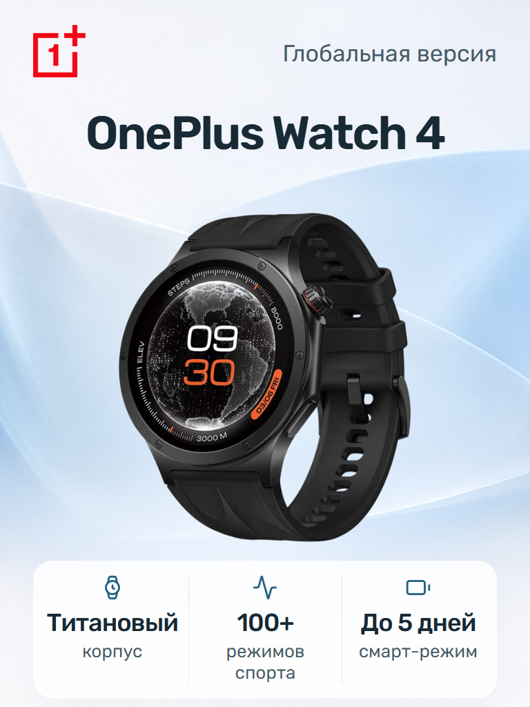

# Meta Product Image

**从产品素材到 3:4 电商主图，一次锁定母版，复用颜色与内存配置。**

为手表、手机和平板制作俄语电商主图的 Skill。采用「Meta 清透层叠」：蓝白曲面背景、清晰的产品展示区，以及三列俄语卖点。产品、Logo 和文字均由本地脚本合成。

<p align="center">
  
</p>

<p align="center"><em>Meta 设计样板 · 具体版本与卖点以实际商品及用户指定的官网资料为准</em></p>

## 从素材到成品

**指定官网 → 整理三个俄语卖点 → 自动排版 → 预览 → 锁定母版 → 生成 SKU**

- **保留真实产品。** 使用原始产品和 Logo 素材，按透明可见边界等比居中，不拉伸、不裁切可见内容。
- **完整展示名称。** 名称自动一至两行，必要时缩小字号；可选配置独立显示在名称下方。
- **卖点有出处。** 只从用户指定的精确型号官网页面整理三条事实，保留重要限定条件，搭配 Lucide 图标。
- **复用已确认设计。** 默认使用内置背景与缓存信息层；换颜色复用布局，换内存只更新配置行。仅在要求换背景时调用生图。

## 开始使用

将本项目作为 Skill 安装到支持本地 Skill 的 Agent 环境，准备产品图和 Logo，然后发送：

```text
使用 $meta-product-image
完整产品名称：[实际完整型号]
版本文字：[实际版本；不需要时省略]
配置：[例如 8/256 ГБ；不需要时省略]
官网网址：[该型号的官方产品页面]
请仅从指定页面整理三个俄语卖点，创建 Meta 母版预览。
```

**新建母版必须提供官网网址。** 未提供、页面无法访问、型号不符或资料不足时，流程停止并请求补充；不会自行搜索或选择替代页面。配置由用户指定，不会从官网的多种规格中自动选择。

预览满意后发送：

```text
锁定母版
```

选择 Meta 设计方向不等于锁定具体产品母版；只有明确锁定后，预览才成为正式母版。

## 同型号，继续生成 SKU

| 需要做什么 | 发送什么 |
| --- | --- |
| 更换颜色 | 上传另一颜色产品图，发送「生成 SKU 变体」 |
| 只换内存配置 | 「同型号，配置改为 12/512 ГБ，生成新 SKU」 |
| 重做母版 | 「重做母版」；可附加背景要求 |
| 重做最近一张 SKU | 「重做当前 SKU」 |
| 重做指定 SKU | 「重做 SKU_VARIANT-A」 |

只换配置无需重传产品图、重新查官网或再次锁定；母版必须已有配置行，且型号、版本及三个卖点仍适用于新 SKU。没有配置行的母版不能直接添加配置。

重做 SKU 时，未指定的产品图、配置和背景沿用该 SKU 当前内容。新结果通过检查后才替换原文件，失败保留旧成品，不消耗新序号。

## 本地运行

依赖 **Python 和 Pillow**，字体与默认视觉素材由项目提供。默认合成流程无需 Node、浏览器或 SVG 渲染库；读取官网资料由执行 Skill 的 Agent 完成。

先安装依赖：

```sh
python -m pip install Pillow
```

从用户指定的官网核实卖点，准备 `features.json` 后，在项目目录运行：

```sh
python scripts/measure_text.py --complete-name "产品完整名称" --product-reference "产品.png" --logo "Logo.png" --features "features.json" --output-root "成品"
python scripts/artifact_flow.py preview --product "产品.png" --product-dir "成品/产品完整名称" --candidate-id a
```

有版本或配置时，在第一条命令追加 `--version "Глобальная версия"` 或 `--configuration "8/256 ГБ"`，使用实际商品信息。Windows 可用 `py -3.12 -X utf8` 代替 `python`。

仅在用户明确锁定预览后执行：

```sh
python scripts/artifact_flow.py bind --product-dir "成品/产品完整名称" --candidate-id a
```

随后按需生成颜色或配置变体：

```sh
python scripts/artifact_flow.py sku --product "另一颜色.png" --product-dir "成品/产品完整名称"
python scripts/artifact_flow.py sku --product-dir "成品/产品完整名称" --configuration "12/512 ГБ"
```

脚本检查三条卖点、图标、网址格式、字形和文字尺寸；官网归属、型号及事实真实性由 Agent 核实。完整执行规则见 [SKILL.md](SKILL.md)。

<details>
<summary>排版与尺寸约定</summary>

- 名称保留完整型号，不截断、不横向压缩；支持主动指定展示名称或一至两行标题。
- 卖点固定三列，说明最多两行。达到最低字号仍放不下时，应精简措辞并保留事实与限定条件。
- 按 768×1024 基准，版本、卖点主句、卖点说明的最低字号分别为 28、32、24 px；配置默认 36 px、最低 32 px，尺寸随画布换算。
- 1536×2048 是逻辑布局坐标，成品采用背景实际尺寸；内置 Meta 背景为 1086×1448。
- 锁定后的 SKU 必须与母版实际尺寸一致，不会通过强制缩放背景来绕过检查。

</details>

## 文件保存

每个完整产品名称使用独立目录：

```text
产品完整名称/
├── output/                         正式成品
│   ├── ORIGINAL_MASTER_FINAL.png
│   ├── SKU_VARIANT-A.png
│   └── SKU_VARIANT-B.png
└── reusable/                       布局、信息层、背景与缓存
```

全尺寸预览放在 `output` 之外。项目仅使用当前 Meta 数据格式，不提供历史格式兼容或迁移。重新设计产品时使用新的输出根目录，保留已有母版与成品。

## 许可

项目采用 [MIT License](LICENSE)。内置 Rubik 字体遵循 [SIL Open Font License](assets/OFL.txt)；产品与 Logo 素材由使用者提供。
